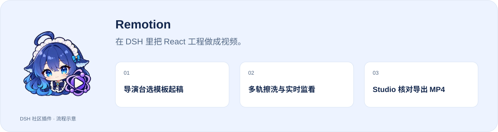
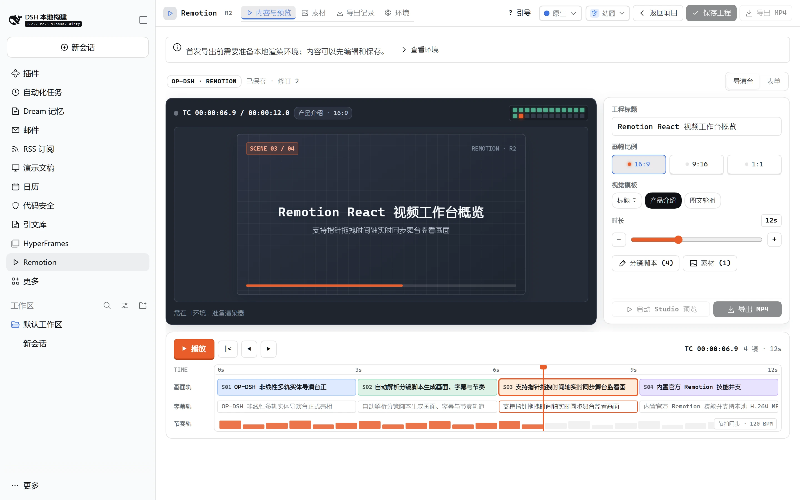

**简体中文** · [English](README.en.md)

# Remotion

**在 DeepSeek Harness 中把 React 工程制作并导出为视频，内置 OP-DSH 非线性多轨实体导演台、13 套明亮风格与 8 套双层字体。**

[](https://www.npmjs.com/package/dsh-remotion) [](https://www.npmjs.com/package/dsh-remotion) [](https://www.npmjs.com/package/dsh-remotion)

**[安装使用](#安装) · [使用流程](#开始使用) · [完整说明](https://github.com/STARDUSTLC666/dsh-remotion/blob/master/docs/REFERENCE.zh.md)**

<picture>
  <source media="(prefers-color-scheme: dark) and (max-width: 640px)" srcset="https://raw.githubusercontent.com/STARDUSTLC666/dsh-remotion/master/docs/assets/intro/workflow-zh-mobile-dark.svg">
  <source media="(max-width: 640px)" srcset="https://raw.githubusercontent.com/STARDUSTLC666/dsh-remotion/master/docs/assets/intro/workflow-zh-mobile-light.svg">
  <source media="(prefers-color-scheme: dark)" srcset="https://raw.githubusercontent.com/STARDUSTLC666/dsh-remotion/master/docs/assets/intro/workflow-zh-dark.svg">
  
</picture>

## 功能

- **OP-DSH 非线性多轨实体导演台（默认）**：凹陷暗色实时监看屏（支持 16:9 / 9:16 / 1:1 动态画面、时间码 `TC` 与可点击 24-LED 渲染矩阵）、右侧机械参数条（画幅键帽、模板胶囊、3–30s 滑杆与内联分镜脚本）以及底部朱红 `▶ 播放` 键与可指针擦洗的 `画面轨 / 字幕轨 / 节奏轨`；支持一键切回经典 `表单` 模式。
- 使用官方 Remotion 技能与工作台模板，管理工程、素材顺序和 Studio 预览。
- 导出本机高清 MP4，保留后续可编辑的工程备份。
- 适配 DeepSeek Harness `>=0.2.2-rc.3`：工作台与弹窗支持 13 套明亮风格（原生清透 / 米白纸感 / Claude 暖书卷 / 8-Bit 掌机 / 晴空薄荷 / 晴昼琉璃 / 护眼墨水屏 / 工程晒图 / 波普孔版 / 千禧复古 / 宋韵朱砂 / 晴空水晶 / 铅字晨报）与 8 套中英双层字体（默认幼圆等宽）。

<details>
<summary>查看实际示例</summary>



图片来自本地 DeepSeek Harness 验证环境的示例工程（8-Bit 像素主题），使用示例内容。

</details>

## 安装

在 DSH 桌面版「插件」面板安装 `dsh-remotion`。已配置命令行时也可使用：

```bash
dsh plugin --profile desktop add dsh-remotion
```

网页版把 `desktop` 改为 `web`；安装后重启对应的 DSH。宿主要求以包声明 `>=0.2.2-rc.3` 为准。

## 开始使用

1. **新建或打开工程**：从左侧栏打开 Remotion，点击顶栏「新建视频」或打开已有工程，默认进入 **OP-DSH 实体导演台**（可随时点右上角切回「表单」视图）。
2. **导演台调参与擦洗分镜**：在右侧实体参数条编辑标题、按机械键帽切换 `16:9 / 9:16 / 1:1`、模板与 3–30s 时长，展开「分镜脚本」逐行编辑字幕；点朱红 `▶ 播放` 键或直接拖动底部 `画面轨 / 字幕轨 / 节奏轨` 指针与 24-LED 矩阵实时预演画面节奏。
3. **保存并整理素材**：先保存工程，再上传图片、音频或静音背景视频；需要时在「素材」页调整图片顺序。
4. **准备环境并 Studio 预览**：首次在「环境」页一键准备官方渲染环境，完成后启动官方 Studio 预览并核对动效。
5. **导出 MP4 与备份工程**：核对导出前摘要后渲染高清 MP4，可在监看屏切至「成片 MP4」播放与下载，并在导出记录获取可编辑工程备份；用工程库搜索和归档整理多个项目。

可以这样说：

> 制作一个 React 视频工程，先确认结构和文案，再用 Studio 预览，最后导出 MP4。

## 开始前要知道

首次使用需准备官方渲染环境；修改工程后需要重新渲染成品。

配置、完整工具与排错见[详细使用说明](https://github.com/STARDUSTLC666/dsh-remotion/blob/master/docs/REFERENCE.zh.md)。

## 插件更新

在工作台或原生插件详情页底部检查更新。默认自动检查，**默认不自动安装**；是否安装、何时重启由你决定。Suite 管理的组件随整包更新。[查看更新规则](https://github.com/STARDUSTLC666/dsh-remotion/blob/master/docs/REFERENCE.zh.md)。

## 文档

- [详细使用、配置与边界](https://github.com/STARDUSTLC666/dsh-remotion/blob/master/docs/REFERENCE.zh.md)
- [更新记录](https://github.com/STARDUSTLC666/dsh-remotion/blob/master/CHANGELOG.md)
- [验证范围与历史](https://github.com/STARDUSTLC666/dsh-remotion/blob/master/docs/VALIDATION.md)

## 反馈与贡献

如果插件帮到了你，欢迎 Star，让更多人发现它。问题和建议请提交 [Issues](https://github.com/STARDUSTLC666/dsh-remotion/issues)，也欢迎代码与文档 [PR](https://github.com/STARDUSTLC666/dsh-remotion/pulls)。反馈时附上版本与复现步骤，并移除凭据。

## License

[MIT](https://github.com/STARDUSTLC666/dsh-remotion/blob/master/LICENSE)

<a id="依赖与配置"></a>

## 技能与环境版本

内置技能与受管理渲染器固定为 4.0.545；13 个官方技能均注册，包含许可证导航。技能通过 DSH 插件更新，已有用户工程及其依赖不会随插件更新被改写。首次显式准备环境后轮询任务，确认真正就绪。桌面已安装 Node/npm 仍报缺失时，检查其启动 PATH；Homebrew ARM 常用 /opt/homebrew/bin，Intel 常用 /usr/local/bin，修改后重启 DSH 再重试。详见[使用说明](docs/USAGE.md)和[技能同步](docs/SKILL-SYNC.md)。
